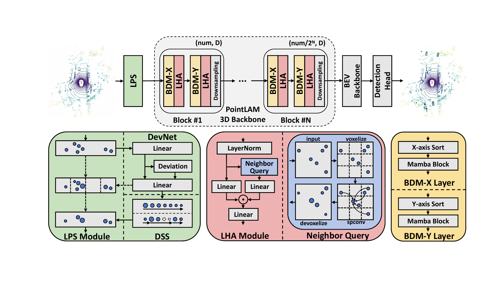

# [ECCV 2026] PointLAM: Local Attentive Mamba for Efficient Point-based 3D Object Detection

**Xuanming Shang, Weijia Zhang, Chao Ma**

PointLAM combines Laplacian point sampling with bidirectional Mamba and local Hadamard aggregation for point-based 3D object detection.



## Getting started

- [Installation](docs/INSTALL.md)
- [Data preparation, training, and validation](docs/GETTING_STARTED.md)
- [Model configuration](tools/cfgs/pointlam_models/pointlam_waymo.yaml)
- [Architecture and implementation](docs/MODEL.md)

## Citation

```bibtex
@inproceedings{shang2026pointlam,
  title={PointLAM: Local Attentive Mamba for Efficient Point-based 3D Object Detection},
  author={Shang, Xuanming and Zhang, Weijia and Ma, Chao},
  booktitle={European Conference on Computer Vision (ECCV)},
  year={2026}
}
```

## Acknowledgements and license

Built on [LION](https://github.com/happinesslz/LION) and [OpenPCDet](https://github.com/open-mmlab/OpenPCDet), with a bundled bidirectional adaptation of [Mamba](https://github.com/state-spaces/mamba).

Released under [Apache 2.0](LICENSE). Upstream notices and the bundled Mamba [license](pcdet/ops/mamba/LICENSE) and [author list](pcdet/ops/mamba/AUTHORS) are retained.
